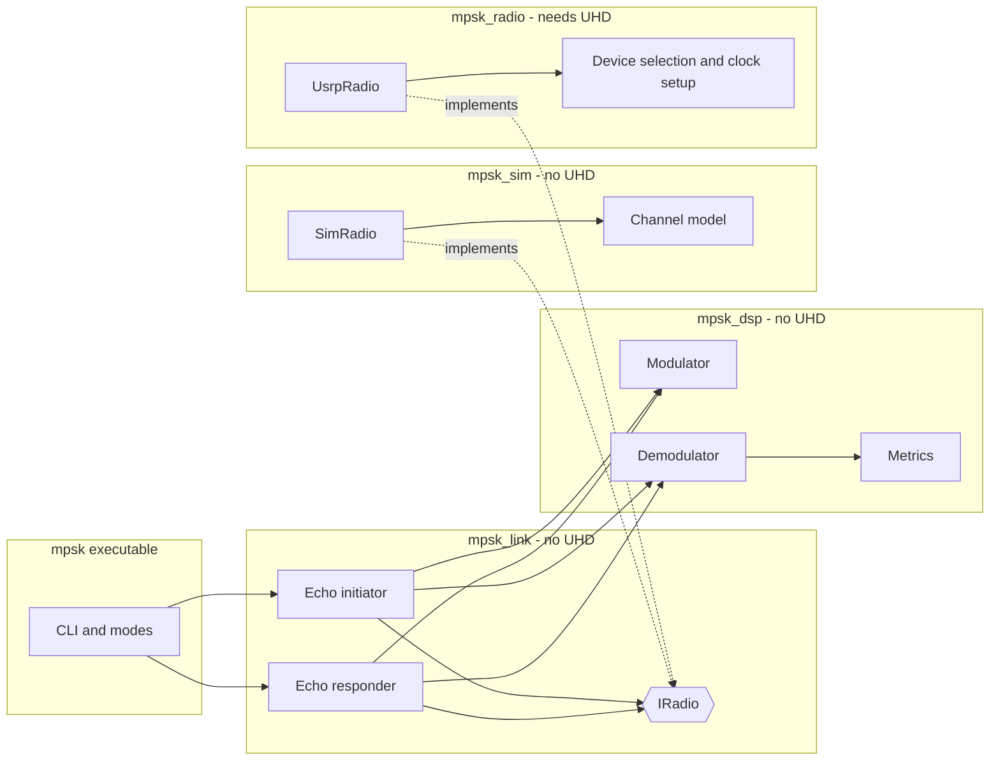
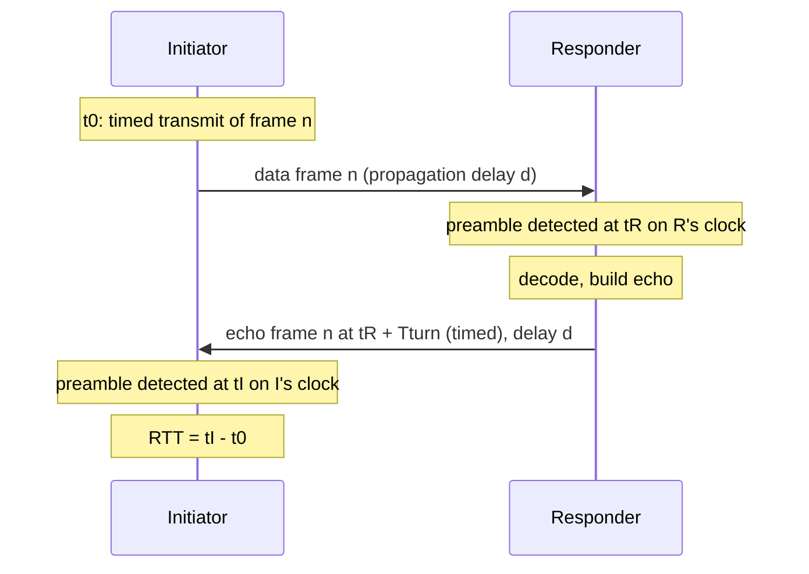

# Design Document

## Overview

This design covers a C++17 M-PSK transceiver for the USRP B200-mini, built on UHD 4.10 (the Homebrew install at `/opt/homebrew`). It is built in two stages: QPSK first, then 8-PSK added on top (Requirement 1).

The main design choices:

| Decision | Choice | Why |
|---|---|---|
| Traffic shape | Short bursts (frames), not a continuous stream | The echo test, the half-duplex rule, and the unknown propagation delay all fit bursts. Each frame is acquired on its own from a preamble. |
| Synchronization | Feed-forward from the preamble, then a decision-directed tracking loop | Burst acquisition is fast and needs no phase-ambiguity logic. The loop only has to track small drifts. |
| Phase-error detectors | Angle-based | They are independent of signal amplitude, which varies over the air. |
| Hardware abstraction | `IRadio` interface with a UHD implementation and a simulated one | The echo logic runs offline against two simulated nodes, so timing and protocol bugs show up without radios. |
| Time | Each unit uses its own device clock. No PPS, no shared timebase | Matches Requirement 8.14. |
| CLI parsing | Small hand-written parser | Keeps the no-UHD build free of Boost. |
| Test framework | A minimal assert-based harness run by CTest | No third-party test dependency. |
| Sample file format | Raw interleaved little-endian `float32` I/Q (`cf32`) | Same layout as UHD's `rx_samples_to_file --type float` and GNU Radio file sinks. |

The sections below say which facts come from documentation and which are assumptions that need hardware to confirm. The last section lists every assumption and decision you may want to revisit.

## Architecture



### Layers and rules

- `mpsk_dsp` has no I/O and no UHD. Every block takes samples or bits in and returns samples or bits. This makes the blocks unit-testable and reusable (Requirement 10).
- `mpsk_io` holds the file and stream code that `mpsk_dsp` must not contain: the `cf32` sample file reader and writer, and the payload sources (seeded PRBS, or a file or stdin). It depends only on `mpsk_dsp`. It was added during implementation of task 5 to keep `mpsk_dsp` free of I/O; the original layout had no home for these.
- `mpsk_sim` holds the channel model and `SimRadio`. It depends only on `mpsk_dsp`.
- `mpsk_link` holds the echo initiator and responder state machines. They talk to hardware only through `IRadio`.
- `mpsk_radio` is the only layer that includes UHD headers. It is built only when `MPSK_WITH_UHD=ON`.
- `app` is one executable, `mpsk`, with subcommands.

### Directory layout

```
CMakeLists.txt
cmake/MpskFindUhd.cmake
src/dsp/        constellation, gray, bits, lfsr, prbs, crc, scrambler, rrc, fir,
                interpolator, dc_blocker, rx_frontend, preamble, framer, modulator,
                preamble_detector, loop_gains, carrier_loop, timing_loop, farrow,
                demodulator, metrics, receiver
src/io/         sample_file (cf32 reader/writer), payload_source (PRBS or file/stdin)
src/sim/        channel_ops, channel, theory, loopback, sweep, sim_radio
src/link/       radio_iface, echo_protocol, echo_initiator, echo_responder
src/radio/      usrp_radio, device_select, clock_setup
src/app/        main, cli, modes
tests/          one test file per DSP block, plus loopback and echo tests
docs/           notes added during implementation
README.md
```

## Signal parameters

| Parameter | Default | Notes |
|---|---|---|
| Master clock | 32 MHz, set explicitly | Ettus documents that the master clock should be set explicitly when synchronizing devices, instead of relying on automatic clock rate selection. The B2xx range is 5 to 61.44 MHz. |
| Sample rate `Fs` | 1 MS/s | 32 MHz / 1 MHz = 32, an integer decimation. After setting the rate, the code reads back the actual rate and exits with an error if it differs from the request. |
| Samples per symbol | 4 | Configurable. |
| Symbol rate `Rs` | 250 ksym/s (`Fs / sps`) | |
| RRC roll-off / span | 0.35 / 11 symbols | Configurable. |
| Occupied bandwidth | `Rs (1 + β)` = 337.5 kHz | Analog bandwidth is set to `Fs`, within the documented 200 kHz to 56 MHz range and not above the master clock. |
| Center frequency | 2.45 GHz | Configurable. See the regulatory note in Requirement 9. |
| Raw bit rate | 500 kb/s QPSK, 750 kb/s 8-PSK | Before framing overhead. |
| Wire / CPU formats | `sc16` / `fc32` | |

USB 3 carries 1 MS/s `sc16` (4 MB/s) trivially. The rate is low on purpose: it leaves host CPU headroom for the receive chain on a laptop.

## Narrowband profile (QO-100 narrowband transponder)

Added after task 10, when the first on-air tests were fixed as the QO-100 narrowband transponder, which is limited to a signal 2.7 kHz wide (AMSAT-DL band plan). Requirement 12. The profile changes the symbol rate by a factor of 125, and that exposes several things the 250 kBd design could ignore.

### Parameters

| Parameter | Default profile | Narrowband profile |
|---|---|---|
| Modulation | QPSK | QPSK (8-PSK in stage 2 would carry 6 kbit/s) |
| Symbol rate | 250 kBd | **2000 Bd** |
| Roll-off | 0.35 | **0.25** |
| Nominal bandwidth `Rs (1 + β)` | 337.5 kHz | **2.5 kHz** |
| Raw bit rate | 500 kbit/s | 4 kbit/s |
| DSP rate (4 samples per symbol) | 1 MS/s | 8 kS/s |
| Frame, 128-byte payload (664 symbols) | 2.66 ms | **332 ms** (preamble 32 ms) |
| Carrier acquisition range (about `Rs/32`) | ±7.5 kHz | **±60 Hz** |

### Occupied bandwidth

Measured on the modulator output (random 128-byte frames back to back, Hann-windowed periodograms; baseband only). Widths in hertz at 2000 Bd:

| Roll-off / span | 99% of power | 99.9% of power | −26 dB | −40 dB |
|---|---|---|---|---|
| 0.25 / 11 | 2200 | 2380 | 2502 | 3090 |
| 0.25 / 21 | 2220 | 2360 | 2473 | 2529 |
| 0.35 / 11 | 2320 | 2540 | 2689 | 2998 |
| 0.35 / 21 | 2340 | 2540 | 2654 | 2725 |

Roll-off 0.25 leaves 200 Hz of margin at −26 dB; 0.35 would sit on the limit. The −40 dB skirts at span 11 are the truncation of the pulse, not the roll-off: a span of 21 pulls them in from 3.09 kHz to 2.53 kHz, and costs nothing that matters at 8 kS/s (84 taps instead of 44). **Proposed: span 21 in this profile**, pending a check that acquisition and the loops are unaffected. The real transmitted spectrum also has the radio's filters, phase noise and PA, which this does not include; it must be checked on a spectrum analyser.

### What must change in the chain

1. **Frequency acquisition.** The preamble estimator's range is a fixed fraction of the symbol rate: at 2 kBd it is ±60 Hz (the loopback at `--rate 8000` decodes at a 60 Hz offset and finds nothing at 100 Hz). At 2.4 GHz 1 ppm is 2.4 kHz, so even GPSDO-locked radios (a few tens of hertz) plus the satellite's transponder oscillator and the downconverter's LO (no figures available) can exceed it. A tone ahead of the frame was proposed and **rejected by the user**, so the frame format does not change. **Proposed instead:** a search over frequency hypotheses. The stage-1 detector tolerates ±60 Hz, so running it on the input derotated by trial offsets spaced about 100 Hz apart covers the search range (default ±1 kHz, about 20 hypotheses), and the hypothesis with the best statistic gives the coarse offset that the existing estimators then refine. The detector ran 28.7 times faster than real time at 1 MS/s on the Mac in task 6; at 8 kS/s each hypothesis sees 125 times fewer samples per second of signal, so twenty hypotheses should cost about 16% of what the 1 MS/s receiver did (an estimate from that figure, not measured at the profile). Shorter preamble segments (a wider estimator range at the price of variance) remain an alternative, and the two can be combined. To be confirmed with the user at the start of task 10A.4.
2. **Rate conversion.** The B200-mini cannot run at 8 kS/s. A forum answer put its minimum at about 192 kS/s; I have not confirmed it. The DSP keeps its few samples per symbol, and a polyphase resampler in the radio layer converts to and from a radio rate of about 250 kS/s. An integer ratio is wanted: 8 kS/s to 256 kS/s is ×32 (the master clock must then divide as UHD allows), 10 kS/s (5 samples per symbol) to 250 kS/s is ×25. To be fixed in task 12 against the real device. The resampler's group delay is compensated in the echo timing.
3. **DC blocker.** Its pole is a fixed `a = 0.9999`, which is a 16 Hz cutoff at 1 MS/s but 0.13 Hz at 8 kS/s with a time constant of 1.25 s, longer than a frame. The 256-sample priming window is also 32 ms at 8 kS/s. Both become time-based: the pole from a cutoff in hertz, much smaller than 2 kHz (a few hertz), and the priming window in milliseconds. The LO leakage spike now falls inside the channel, so the radio tunes with an LO offset. The finding from task 10 (the blocker removes the DC of a dense burst train) needs re-measuring at the new rate, where a frame is 0.33 s and the gaps are seconds.
4. **Separate uplink and downlink.** TX at 2.4 GHz on the `TX/RX` port, RX through a downconverter at an intermediate frequency on `RX2`. `--tx-freq` and `--rx-freq` replace the single `--freq` (the first draft of the CLI had one), and the antennas and gains are per direction. The echo test's single-antenna-port criterion (8.15) applies to the conducted test only. UHD tunes the two directions independently, which I have not confirmed on this device.
5. **Spectral inversion.** If any stage in the path inverts the spectrum (a downconverter with the LO above the signal, or an inverting transponder; I do not know whether the QO-100 narrowband transponder is one), the received QPSK is conjugated: the constellation is mirrored and the Gray labels are wrong. The preamble and header are real BPSK, so they decode regardless and give no warning. A receive option `--invert-iq` conjugates the input; the carrier offset's sign also flips.

### Two stations, half duplex, over the satellite

Each station transmits on the uplink and listens on the downlink. The transponder retransmits everything in its passband, so **a station hears its own signal about 0.25 s after it sends it**. The delay is 2 × slant range / c: 36 000 km to 41 700 km gives 0.24 s to 0.28 s per hop, and a hop is station to satellite to station. With a 128-byte frame (0.332 s) the returning copy of a station's own frame arrives while it is still sending the end of it. Because it is half duplex, a station is deaf while transmitting (the first 80 ms of its own returning frame), and it ignores the rest of it by frame type: the initiator sends data frames and accepts only echo frames, the responder the reverse. That uses the type field the header already has, and nothing new. A frame ignored this way is counted and reported (a ready measurement of the up and down path as a bonus, if frames are shortened below the hop delay; not in scope).

Timeline, initiator A and responder B, with one-way hop 0.25 s, frame 0.332 s, `T_turn` 0.5 s:

| Time (A's clock) | Event |
|---|---|
| 0.00 – 0.33 s | A transmits data frame n |
| 0.25 – 0.58 s | A hears its own frame n through the satellite, ignores it (type data) |
| 0.25 – 0.58 s | B receives frame n; at 0.58 s the frame is complete and decoded |
| 0.75 s | B starts the echo (0.5 s after the frame's start at B) |
| 1.00 – 1.33 s | A receives the echo; B hears its own echo back and ignores it |
| 2.00 s | A sends frame n+1 (the next interval) |

Round trip as A sees it: about 1.0 s, which is 0.5 s of path plus `T_turn`. The sample period at 8 kS/s is 125 µs, 37.5 km of path per sample, which is fine for a delay measured in tens of milliseconds, and the "one-way delay" the initiator reports will read about 0.25 s.

Profile defaults for the echo test, to be confirmed on air: `T_turn` 0.5 s (it must exceed the frame, the host latency and the decode); `--max-range-km` 84 000 (the longest station to satellite to station path); timeout `T_turn + T_frame + 2 × 0.28 s + 0.1 s` which is about 1.5 s; interval 2 s. At 4 kbit/s raw, a 128-byte payload every 2 s is a low duty cycle, so the transponder sees one short burst in six.

## Components

### Constellation and Gray coding (`constellation`, `gray`)

An M-PSK point is `exp(j(2πk/M + φ₀))`, which has unit power by construction (Requirement 1.4). Bits map to the index `k` through the inverse Gray code, so neighbouring points differ by one bit (Requirement 1.3).

- QPSK: `φ₀ = π/4` (points at 45°, 135°, 225°, 315°).
- 8-PSK: `φ₀ = 0`.
- The table is built at run time from `M`, so mapper and demapper are generic over `M` (Requirement 1.5). A `supported_orders()` list is `{4}` in stage 1 and `{4, 8}` in stage 2. Asking for anything else, including 8-PSK in stage 1, fails with a clear message (Requirement 1.8).
- The demapper is a hard-decision slicer: the nearest point by angle. It also returns the decided point so the carrier loop and the EVM calculation can use it.

### Framing (`framer`, `preamble`, `crc`, `scrambler`, `prbs`)

Each frame is a burst:

```
| guard | preamble (64 sym, BPSK) | header (BPSK) | payload (M-PSK) | guard |
```

- **Preamble.** A 63-chip m-sequence (`x⁶ + x⁵ + 1`) plus one extra chip, sent as BPSK (symbols 0 and π). It is the same for QPSK and 8-PSK, so receiver detection does not depend on the payload modulation. Sixty-four symbols split into four segments of 16, which the frequency estimator uses (see the receiver below). Which rotation of the sequence and which extra chip to use was settled by exhaustive search over 252 variants. The chosen one has a worst coherent autocorrelation sidelobe of 6 against a peak of 64 (-20.6 dB). The detector uses a different statistic, the non-coherent sum over the four segments, and under that one every variant lands between -8.3 and -10.1 dB (the chosen one is -8.6 dB, the median -9.6 dB). The detector figure is a property of any 64-symbol m-sequence split this way, not of the choice, so the detection threshold has to be set with a sidelobe of about 0.14 of the peak in mind. Both figures are pinned in `test_preamble`.
- **Header.** Sent as BPSK so it can be decoded before the payload modulation matters and at lower SNR than the payload. Fields: magic and version (1 byte), frame type `data` or `echo` (1 byte), modulation code (1 byte), frame counter (2 bytes), payload length in bytes (2 bytes), CRC-16 over those fields (2 bytes). That is 9 bytes, or 72 symbols.
- **Payload.** Optionally followed, for `echo` frames, by a 12-byte trailer with the responder's forward-leg measurements: echoed frame counter, EVM in 0.1 dB, residual frequency offset in Hz, level in 0.1 dBFS, bit error count, flags. A CRC-32 covers the payload and trailer.
- **Scrambler.** The header and the payload section each pass through an additive scrambler (`x⁷ + x⁴ + 1`), restarted from the same fixed seed for each of the two. They are separate so the receiver can decode the header before it knows anything about the payload. Scrambling comes after the CRC-32 is appended, so the CRC bits are scrambled too. File data with long runs of zeros would otherwise starve the timing loop of symbol transitions.
- **Padding.** The payload section is padded with zero bits to a whole number of symbols. QPSK never needs it (a whole number of bytes is an even number of bits), but 8-PSK does whenever the section length is not a multiple of 3 bits. The receiver drops the padding using the length from the header.
- **Payload size cap.** The header field could carry up to 65535 bytes, but both the builder and the parser enforce 4096 (about 66 ms of QPSK). Without a cap, a header that passed its CRC with an absurd length would make the receiver wait for that many symbols.
- **Corrupted frames.** Decoding functions report them in their result and do not throw. Exceptions are for invalid arguments to the builders.
- **Pseudorandom payloads.** `payload = PRBS(seed, frame counter)`, so any unit that knows the seed can regenerate the expected bits for any frame counter. This is how the responder measures forward-leg BER (Requirement 8.7).

Default payload is 128 bytes plus the 4-byte CRC-32, which is 1056 bits. The preamble is 64 symbols and the header is 9 bytes, which is 72 BPSK symbols. A QPSK frame is then 64 + 72 + 528 = 664 symbols (about 2.7 ms at 250 ksym/s), and an 8-PSK frame is 64 + 72 + 352 = 488 symbols. An echo frame adds the 12-byte trailer. The header CRC and payload CRC detect corrupted frames (Requirement 4.3). They are not used for BER, which always compares against known bits.

### Transmit chain (`modulator`)

bits → scramble → map → insert preamble/header → upsample by `sps` → RRC filter → scale → guard samples.

The RRC taps use the closed form, with the two singular points handled explicitly (Requirement 2.6):

- `t = 0`: `h = (1 + β(4/π − 1)) / T`
- `t = ±T/(4β)`: `h = (β/(T√2)) [ (1 + 2/π) sin(π/(4β)) + (1 − 2/π) cos(π/(4β)) ]`
- otherwise: `h = [ sin(πt(1−β)/T) + (4βt/T) cos(πt(1+β)/T) ] / [ (πt/T)(1 − (4βt/T)²) ]`, scaled by `1/T`.

The taps are normalized to unit energy, so the shaped signal has an average power of 1/sps and the cascade of transmit and matched filter has a centre value of exactly 1. The output is multiplied by a fixed scale (default 0.5, configurable, in (0, 1]). A fixed scale, not a per-burst normalisation, keeps the transmitted power the same from frame to frame, which the level reports and the BER-versus-SNR comparisons rely on.

Measured for QPSK at 4 samples per symbol and a roll-off of 0.35: at scale 1.0 the largest peak over 400 frames is 0.793 (crest factor 1.6), so the default scale gives a peak of about 0.40 of full scale. Crafted payloads built to maximise the peak reach 0.79, so this is close to the true ceiling. The headroom depends on the configuration: at 2 samples per symbol the peak at scale 1.0 is 1.12 and would clip, which is why each burst reports its own peak for the caller to check. The 8-PSK peak has not been measured yet and is a stage 2 check.

Each burst has 64 samples of silence at both ends (configurable). The burst also reports `first_symbol_peak_index` (guard plus the filter group delay), and the echo timing is defined from that point, so the guard length does not affect ranging.

### Receive chain (`rx_frontend`, `preamble_detector`, `carrier_loop`, `timing_loop`, `farrow`, `demodulator`)


1. **DC removal.** A one-pole blocker, `y[n] = x[n] − x[n−1] + a·y[n−1]` with `a = 0.9999`, giving a cutoff around 16 Hz at 1 MS/s. It removes LO leakage and converter offset without cutting into the signal. State is reset after the unit's own transmissions. **How it starts matters, and both obvious choices are wrong.** From a zero state it passes a DC offset and only decays it with a time constant of 1/(1 - a) = 10 ms: 76% of the offset is still present 2.7 ms after the reset (a whole frame). Priming from the first sample alone, which is what this design originally said, removes that step but takes that one sample's noise for DC, and the error decays over the same 10 ms. Measured on white noise, the noise power gain is 1.89 just after such a start, 1.6 at 2.7 ms, and about 20 ms pass before it reaches 1; on a short record it made the receiver noise 8 times too high and cost about 6 dB. So `process()` primes from the **mean of the first 256 samples** of the stretch (the error of a mean falls as 1/N), then filters from that state. Measured with N = 256: noise power gain 1.002 and residual DC about 0.5% of the offset in the first 2.7 ms, for a one-off look-ahead of 0.26 ms. N = 1 gives 1.70 and 8%, N = 64 gives 1.01 and 1%. `push()` cannot look ahead and falls back to the one-sample prime, so the front end uses `process()`. The cost is that the first block after a reset must be at least 256 samples to get the full benefit; a shorter one is primed from its own mean. **What the blocker costs.** It cannot tell a station's DC offset from the DC of its own bursts. A burst train has a genuine mean: 1.5% of the symbol amplitude for 8-byte frames, 2.0% for 128-byte frames, 0.8% for 1024-byte frames, at 256 samples between bursts. The blocker settles on that mean over about 10 time constants (100 frames at this duty cycle) and then subtracts it, which leaves a deterministic error of about twice the mean, because the unit-energy matched filter has a DC gain of about 2 at 4 samples per symbol (confirmed: an error of 1.45e-2 against a train mean of 7.3e-3). Measured in a noiseless train of 500 8-byte frames: the EVM of the first frame is 0.83%, the median is 4.0% and the worst 6.2%, with no bit errors; for 128-byte frames the mean EVM SNR over 100 frames is 37 dB against 40 dB for one. It matters only for a dense train of short frames. The echo test sends one frame every 200 ms (a duty cycle of about 1%, and the blocker is reset after each transmit window), so the effect there should be much smaller, but that is an expectation and I have not measured it. If it ever matters, the remedy is a lower pole (a longer time constant) or a blocker that is frozen during bursts.
2. **Matched filter.** The same RRC as the transmitter, at the sample rate.
3. **Detection, tolerant of carrier offset.** The matched-filter output is correlated with the preamble waveform in four 16-symbol segments, giving partial correlations `c₀…c₃`. Within a segment a small carrier offset rotates the phase only a little, so a segment still adds coherently. The loss grows with the offset: across a 16-symbol segment the rotation is 5.8 degrees at 250 Hz, 58 degrees at 2.5 kHz (statistic power loss 0.37 dB), and 180 degrees at the +-7.8 kHz edge of the acquisition range (loss 3.9 dB). The detection threshold must leave room for that 3.9 dB at the edge of the range. Combining them non-coherently and normalising by the received energy gives the statistic `D = Σₖ|cₖ|² / (16·E)`, which lies in [0, 1], reaches 1 only for a perfect preamble, and does not depend on amplitude or on the carrier offset (Requirement 9.3, no AGC needed). Its noise-only law is exact: the 64 symbol-spaced noise samples are independent, so D is the squared length of the projection of a random unit vector in C⁶⁴ onto a fixed 4-dimensional subspace, which is Beta(4, 60): mean 1/16, standard deviation 0.030, and `P(D > t) = Σⱼ₌₀³ C(63,j) tʲ (1−t)⁶³⁻ʲ`. Measured over 1.5 million positions: mean 0.0625, sd 0.0300, and 2.20e-5 above 0.25 against a theoretical 2.30e-5.

   **One threshold on D cannot do the job, so detection has two stages.** The peak of D at a carrier offset f is `sinc²(16f/Rs)`, falling to 0.405 at the +-7.8 kHz edge. A threshold high enough to give few false triggers on noise (above about 0.5) would miss a signal near the edge, and one low enough to catch it (0.25) fires about 23 times a second on noise at 1 MS/s. So stage 1 uses the low threshold (0.25), and each crossing goes to stage 2, which measures the frequency, derotates, and applies a fully coherent test `V = |C|²/(64·E)` with a threshold of 0.30. For noise V averages 1/64 and has a thin tail; for a preamble at symbol SNR g it is about `(64 + 1/g) / (64 (1 + 1/g))` (measured 0.913 at 10 dB against 0.912, and 0.768 at 5 dB against 0.764). The 33 stage-1 crossings in 1.5 million noise samples were all refused, the largest V among them being 0.251.

   The scan finds the peak of D over two symbols after the first crossing and hands that to stage 2. The first crossing is at most about 2.5 samples before the true peak (worst at a half-sample delay), and stage 2 recovers the position from the crossing alone in every case measured, so the peak search is a safety margin. A refused candidate is stepped past by one symbol from its peak; stepping by one sample re-counts the same noise lobe (37 candidates instead of 28 on the same record). A scan that starts up to 2 samples after the true position still finds the preamble, and from 3 samples after it does not.

   **Speed.** Stage 1 runs at every sample position, so it uses only the cheap part of the analysis: four segment sums and the energy, with no trigonometry. The first version also computed the stage-2 quantities there (64 `std::polar` calls per position) and ran at 2.1 times real time at 1 MS/s on a recent Mac; separating them gives 28.7 times real time with an identical statistic. Not measured on a Raspberry Pi.
4. **Estimation from the preamble.**
   - *Carrier frequency.* Differential combining of adjacent segments, `arg(Σ cₖ cₖ₋₁*) / 16` in radians per symbol, gives the offset. This is the Luise-Reggiannini approach. Adjacent segments are 16 symbols apart, so the unambiguous range is `±Rs / (2·16)` = **±7.8125 kHz** at `Rs` = 250 ksym/s. **Measured reliable range: 96% of that, 7.5 kHz.** At Es/N0 = 12 dB with 200 trials per point: all found with frequency error under 90 Hz out to 7500 Hz, 193 of 200 at 7700 Hz, 137 at 7800 Hz, 75 at 7900 Hz, 1 at 8200 Hz, and none at 9 kHz or above. The last few percent are marginal because the stage-1 peak is only 0.405 there. Beyond the range nothing is reported, which is the right way to fail. Documentation should state 7.5 kHz, not the theoretical 7.8125 kHz.
   - *Timing.* The coherent magnitude (with each position's own frequency estimate removed) is evaluated at the integer positions around the stage-1 peak, and a parabola through the best three gives a fractional position. The position is then refined by reading the signal at that fractional position with a windowed-sinc interpolator and re-measuring. Measured error, rms in samples: 0.023 at 20 dB, 0.062 at 10 dB, 0.113 at 5 dB, 0.19 at 0 dB. This is adequate and is better than an earlier estimate in this document suggested (it claimed the parabola's curvature was too weak; at 4 samples per symbol the coherent magnitude falls 10.6% over one sample, so it is not). Swept across a whole sample of delay the noiseless error stays under 0.06.
   - *Phase and amplitude.* The phase and magnitude of the coherent sum give the absolute carrier phase and the received amplitude. **The phase is referenced to the centre of the preamble (symbol 31.5), not its first symbol.** An error `e` in the frequency estimate moves the phase of the coherent sum by `e` times the centroid of the weights, and the centroid of `(i − 31.5)` is zero, so the centre phase is unaffected by the frequency error, whereas a phase referenced to symbol 0 would carry `31.5·e`. The receiver extrapolates with `phase_at()`. Measured rms phase error: 0.009 rad at 20 dB, 0.027 at 10 dB, 0.071 at 2 dB. The amplitude has no measurable bias (within 0.1 dB down to 0 dB) and holds across a 60 dB level range with a DC offset present. Because the preamble is known, the phase is absolute, so there is **no phase ambiguity to resolve** for QPSK or 8-PSK (Requirement 3.6). The ambiguity only returns if the tracking loop slips a cycle (see risks).
   - *Measured detection floor.* With the DC blocker working as designed, 150 of 150 preambles are found at Es/N0 = 0 dB, the smallest V being 0.35 against the 0.30 threshold. The 64 symbols give about 18 dB of processing gain.
5. **Symbol-rate samples.** A cubic Farrow interpolator (`farrow`) picks samples at the estimated timing. The loops start at the first header symbol (symbol 64) from the preamble's estimates: phase `phase_at(64)`, frequency `omega`, and position `est.position + 64·sps`. Interpolation error against an ideal sinc interpolator, measured: -61 dB at a fractional offset of 0.1, -54 dB at 0.25, -51 dB at 0.5 (0.27%). That is the floor under the 1.0% clean-frame EVM, together with the finite RRC span (0.5%), and it is far below the noise at any useful SNR.
6. **Tracking loops.** Both are second-order loops in the Rice form: `I += Ki·e; v = Kp·e + I; x += v`. Gains come from the damping factor `ζ` and the normalized noise bandwidth `BₙT` (`loop_gains`): with `θ = BₙT / (ζ + 1/(4ζ))` and `D = 1 + 2ζθ + θ²`, `Kp = 4ζθ / D` and `Ki = 4θ² / D`, each divided by the detector gain. The loop's true noise bandwidth against the target is 1.001, 1.003, 1.009, 1.027 and 1.092 at `BₙT` of 0.001, 0.003, 0.01, 0.03 and 0.1, so the formulas should not be used above about 0.1.
   - *Carrier.* A decision-directed PLL with detector `e = arg(y · conj(d))`, where `d` is the decided point (gain 1, any `M`, independent of amplitude). Defaults: `ζ = 0.7071`, `BₙT = 0.01`. Its phase jitter is `sqrt(BₙT / g)` for symbol SNR `g` (an earlier version of this document had a factor of 2 inside the root, which was wrong). Measured at `BₙT` = 0.01: 0.0100, 0.0179, 0.0254 and 0.0327 rad at 20, 15, 12 and 10 dB. **A decision-directed loop locks only modulo π/2 for QPSK.** It would be happy at any of four rotations. The absolute phase from the preamble starts it in the right one, which is why the loop is started from `phase_at(64)` and why the BPSK header (modulo π) is not a source of ambiguity.
   - *Timing.* A Gardner detector, `e = Re{ (cur − prev) · conj(mid) }` on derotated samples, which is positive when sampling late, so the loop subtracts it. It tracks sample-clock offset over the whole frame (Requirement 7.5). Default `BₙT` = 0.003. **The detector gain is not a constant.** It depends strongly on the roll-off and a little on the modulation, and it is per symbol regardless of `sps`. The converged QPSK values are 0.609, 1.063, 1.487 and 2.626 for β = 0.2, 0.35, 0.5 and 1.0. (Earlier values of 0.574, 1.004, 1.402 and 2.522 came from short runs and were 4 to 7% low; the standard deviation of a short-run average is 0.056, 0.030, 0.017 and 0.0056 for 1k, 3k, 10k and 40k symbols.) So `Demodulator` measures the gain once at construction (`TimingLoop::measure_detector_gain`: 20 000 symbols of the configured pulse, about 15 ms) and reuses it for every frame. A hard-coded constant would be wrong as soon as β changes. BPSK reads about 10% higher (1.11 at β = 0.35, one run).
   - *Decision order.* The header is decoded as BPSK and the loops use BPSK decisions; the payload switches to the header's modulation.
   - *Measured performance* (QPSK, β = 0.35, 4 sps, 16-byte payload, defaults). Clean frames: zero errors in 40 960 bits at every offset to ±7.5 kHz, EVM 1.0% (1.2% at 7.5 kHz). The EVM-based SNR is within 0.2 dB of the true Es/N0. BER over 400 frames at 10 dB is 8.6e-4 against an ideal 7.8e-4 (1.10 times), and 6.5e-3 against 6.0e-3 at 8 dB. Carrier `BₙT` sweep at 10 dB, as a multiple of ideal BER: 0.002 gives 13.6 (too narrow to pull in), 0.005 gives 1.17, 0.01 gives 1.10, 0.02 gives 1.17, 0.05 gives 1.43. Timing `BₙT`: 0 gives 1.10, 0.001 gives 1.06, 0.003 gives 1.10, 0.01 gives 1.24, 0.03 gives 3.16 with 9 frames lost.
   - *Pull-in* (whole demodulator, noiseless): a starting frequency error up to 1500 Hz is recovered and 2500 Hz is not, a starting phase error up to 69 degrees and not 115, and a timing error up to 1.0 sample and not 1.5. The preamble leaves far smaller errors than these. The bare timing loop pulls in from -1.5 to +2.0 samples and slips a whole symbol (±4 samples) beyond that.
   - *Clock offset.* On a 4096-byte frame (16 536 symbols) with the timing loop frozen, 20 ppm already fails; with the loop on, there are zero errors up to 400 ppm. `clock_offset_ppm` is the loop's averaged drift and reads 16, 52, 97, 197 and 400 for true offsets of 20, 50, 100, 200 and 400. **It is not usable for small offsets:** on a drift-free signal the loop's own self-noise gives a reading rms of 0.8, 7.6 and 86 ppm at `BₙT` of 0.001, 0.003 and 0.01, so a single reading below about 20 ppm says nothing. Averaging over many frames is the way to measure a small offset.
7. **Decode.** Header first: BPSK-demap, descramble, check the CRC. If it fails, the frame is reported as lost and the payload is not decoded (Requirement 4.3). Failures are returned in the result, never thrown. The payload is then demapped, descrambled, and checked against its CRC-32. A buffer that ends inside the frame is reported as `truncated`, with whatever was decoded kept; a frame completes once the buffer is 6 samples past the last payload symbol (the interpolator and filter look-ahead). A noise burst on the header of rms 0.2 still decodes, and one of rms 1.0 or more loses the frame.

### Metrics (`metrics`)

- **EVM.** RMS of `|y − d|` over payload symbols (not the header), relative to unit magnitude (`EvmAccumulator`). Reported as a percentage and as an SNR estimate `−20·log10(EVM)` in dB. This holds when errors are small; at low SNR, wrong decisions make it optimistic.
- **BER.** `payload_ber()`: Hamming distance between the decoded bits and the known bits, over the payload. A length mismatch is reported separately, not counted as errors.
- **Residual frequency offset.** `omega` is the carrier loop's frequency averaged over the payload (the loop starts from the preamble's estimate, so this is the coarse estimate plus the integrator state); `cfo_hz(Rs)` converts it. Measured over 40 trials at 10 dB: the preamble estimate is good to about 60 Hz rms, and the averaged loop value is under 10 Hz and under 0.3 of the preamble's error.
- **Level.** `measure_signal_level()`: RMS of the frame samples in dBFS, from the `fc32` values (full scale = 1.0). This is not calibrated dBm. The caller supplies the sample range.
- **Clipping.** Count of samples where `|I|` or `|Q|` is at least 0.98 before the DC blocker (`measure_signal_level`, threshold configurable). A non-zero count raises the "input level too high" warning (Requirement 7.12).

## Radio abstraction

```cpp
struct RxBlock {
  std::vector<std::complex<float>> samples;
  double t_first;     // device time of samples[0], seconds, relative to a stream epoch
  bool   overflow;    // samples were dropped before this block
};

enum class SendResult { Ok, Late, Underflow, Error };

class IRadio {
 public:
  virtual ~IRadio() = default;
  virtual double sample_rate() const = 0;
  virtual double now() const = 0;                          // device time, seconds
  virtual bool   receive(RxBlock& out, double timeout_s) = 0;
  virtual SendResult send_burst(const std::vector<std::complex<float>>& s,
                                double t_start) = 0;       // timed transmit
};
```

Times are `double` seconds measured from a per-session epoch (the first receive timestamp). Over a multi-hour run the value stays below 1e5 s, so the resolution is better than 1e-10 s, far finer than one 1 µs sample.

The echo logic and the receive chain use only `IRadio`. `UsrpRadio` and `SimRadio` implement it.

## UHD layer (`mpsk_radio`)

### Device selection (Requirements 5.8 to 5.11)

1. Call `uhd::device::find(args)` before `multi_usrp::make`.
2. Zero matches: print "No USRP found for arguments '…'. Check the USB 3 cable and run uhd_find_devices", exit non-zero. No exception reaches the user.
3. More than one match: list the serial numbers and exit, so the user passes `--args serial=XXXX`. The code never picks one silently.
4. If `make` throws because the unit is busy or the FPGA image is missing, catch `uhd::exception`, print its message plus a hint (is another process using the device, has `uhd_images_downloader` been run), and exit non-zero.

Default `--args` is `type=b200`. B200-mini and B210 share this driver, so no product string or serial is hard-coded.

### Configuration order

Master clock, then `clock_source`, then wait for reference lock, then sample rate, center frequency, gain, bandwidth, antenna.

### Clock source and reference lock (Requirements 5.12 to 5.15)

- `--clock-source internal|external`, default `internal`.
- For `external`, the code calls `set_clock_source("external")`, then polls the `ref_locked` motherboard sensor until it reports locked or a timeout expires (default 10 s). On timeout it prints an error naming the clock source and exits non-zero.
- If the unit exposes no `ref_locked` sensor, the code prints a clear warning that lock cannot be verified in software and continues. This is a choice I made for a case I could not check; see the open decisions.
- At startup it prints the clock source and lock state.
- On the B200-mini, the external 10 MHz and PPS inputs share one connector (J3). Ettus documents the maximum input as +15 dBm, and the board has a reference-lock LED and a reference-present LED. The required signal level is not stated in the pages I could read, so the README tells the user to confirm it in the datasheet before connecting. Only the 10 MHz reference is used; PPS is out of scope.

### Gain, antenna, bandwidth

- Gain ranges are read at run time with `get_tx_gain_range()` and `get_rx_gain_range()`. Requested gains are clamped to the range, with a message when clamped (Requirement 5.2). Ettus lists about 89.8 dB of TX gain and 76 dB of RX gain for the B2xx frontends, but the code does not rely on those numbers.
- Antenna defaults: TX uses `TX/RX`. RX uses `RX2` in one-way `rx` mode and `TX/RX` in the echo roles, so one cable carries both directions (Requirement 8.15). Both stay configurable.
- Bandwidth is set to the sample rate by default and can be overridden.

### Streaming

- One `tx_streamer` and one `rx_streamer`, CPU format `fc32`, wire format `sc16`.
- *Transmit.* Each frame is one burst: a single `send` with `start_of_burst` and `end_of_burst` set, and `has_time_spec` set to the scheduled start (Requirement 5.4). Underflows and late commands are read from the async message queue after each burst. Event code "underflow" prints `U`; "time error" (late) maps to `SendResult::Late` (Requirements 5.5 and 8.6).
- *Receive.* Continuous streaming started with `start_continuous` and a start time slightly in the future. The `rx_metadata_t` time stamp of each block gives `t_first`. An overflow error code prints `O` and sets the `overflow` flag (Requirement 5.6).
- *Threading.* One thread runs receive, demodulation, and the echo state machine. At 1 MS/s the per-block work is small, but this is an assumption about host CPU headroom that needs a real run to confirm; if overflows show up, the receive loop moves to its own thread behind a ring buffer.
- *Ctrl-C.* A signal handler sets a `std::atomic<bool>`. The loops check it between blocks, stop the stream, and print the summary (Requirement 5.7).

## Echo test (`mpsk_link`)

### Roles and flow



- **Initiator.** For each exchange: build frame `n` (PRBS payload from the shared seed and `n`), send it at a scheduled time, then receive until the echo arrives or a timeout expires.
- **Responder.** Receives continuously. When a data frame decodes, it builds an echo and sends it at a timed start.
- **Half duplex (Requirement 8.2).** Each unit transmits only inside its scheduled window and ignores its own transmit window on receive: from the burst start minus a margin to the burst end plus the receive-to-transmit switching margin, it discards samples and then resets the DC blocker and detector state. A unit never tries to decode its own signal.

### Timing definitions

All timing is relative to the preamble start, which is known in both the transmit burst (a fixed sample offset) and the receiver (the refined correlation peak, minus the known filter delay).

- `t_tx_ref` is the device time at which the preamble start leaves the transmitter's DAC reference point, computed from the burst start time plus the fixed preamble offset.
- `t_rx_ref` is the device time of the detected preamble start, from the block time stamp plus the sample index and the fractional timing estimate.

The responder sets the echo burst so that `t_tx_ref(echo) = t_rx_ref(frame) + T_turn`. The initiator measures

```
RTT = t_rx_ref(echo) − t_tx_ref(frame)          both on the initiator's clock
one-way delay d = (RTT − T_turn − T_cal) / 2
distance = d × c
```

where `T_cal` is an optional calibration offset (`--rtt-offset-us`). The conducted test with a known cable gives the baseline value of `RTT − T_turn`, which the user then passes as `T_cal`. Without it, the figure includes the combined hardware group delay of both units (converter, filters, FPGA), which is uncalibrated.

**Accuracy limits (Requirement 8.11).** The sample period is 1 µs, which is about 150 m of one-way distance per sample. The fractional timing estimate improves on that, but the hardware delay offset is larger than the sample-level resolution, so absolute distances are only meaningful after calibration, and short distances will read as near zero after calibration. If the two clocks run at different rates, the turnaround time measured on the responder's clock is off by `Δppm × T_turn`: negligible with GPSDO-disciplined references, and 150 ns (about 22 m one-way) for 3 ppm at a 50 ms turnaround on internal oscillators.

### Turnaround and lead time

- The responder timeline: frame start at `t_rx_ref`; frame end about 2.7 ms later; decode finishes after some host latency; then the echo is sent.
- Default `T_turn` is **50 ms**, configurable. It must exceed the frame duration, the host's receive latency, the decode time, and the time for the echo samples to reach the device before their scheduled start. I could not measure host latency here, so 50 ms is an estimate with a wide margin, not a measured value.
- The responder prints the **margin** (scheduled start minus device time when the burst was handed over) for each echo. If the margin is small or negative the user sees it immediately and raises `--turnaround-ms`.
- If the radio reports a late command, or the margin is negative before the send, the responder skips that echo, increments a counter, and prints it (Requirement 8.6).

### Initiator scheduling

- Echo timeout: `T_turn + T_frame + 2·d_max/c + margin`, where `d_max` is `--max-range-km` (default 10) and `margin` defaults to 20 ms. Propagation delay is about 3.34 µs per km, so even 100 km adds only 0.67 ms. The delay is never the limiting factor. What limits the range is link budget, which this software does not model.
- Interval between exchanges: at least the timeout, so a late echo cannot be mistaken for the next one. Default 200 ms, configurable.

### Echo content

- `--echo-mode decoded` (default): the responder re-modulates its decoded bits. This is a true echo, so the end-to-end BER includes errors from both legs.
- `--echo-mode reference`: the responder sends the known PRBS for that frame counter instead of its decoded bits. The return-leg BER is then exact and independent of forward errors.
- The initiator reports forward-leg numbers from the echo trailer, and return-leg EVM, frequency offset and level from its own measurements. Return-leg BER is exact in `reference` mode; in `decoded` mode it equals the end-to-end BER when the forward leg had zero errors, and is reported as "not separable" otherwise.

### Reports

- Per exchange (initiator): frame counter, echo received or lost, forward-leg EVM/offset/BER, return-leg EVM/offset/BER, end-to-end BER, RTT, estimated one-way delay.
- Summary on exit or Ctrl-C (initiator): exchanges, echoes received, echoes lost, min/mean/max RTT, mean and worst BER per leg.
- Responder: running counts of frames received, echoes sent, echoes skipped (late or undecodable), and forward-leg BER.
- A `--log` option writes the same fields as CSV lines, one per exchange, for pasting into a test log (Requirement 7.15).

## Channel simulator and loopback (`mpsk_sim`)

### Channel model

Applied in this order (`Channel`): bulk delay (integer samples plus fractional, from a windowed-sinc interpolator), amplitude scale, carrier frequency offset, phase offset and slow phase drift, sample-clock offset in ppm (a slowly varying fractional delay), then AWGN. The simulator adds nothing else: no multipath, no fading, no I/Q imbalance. The building blocks are in `channel_ops`; `Channel` composes them and is the thing the loopback, the sweep and later the simulated radio use.

- **Order matters, and the tests check it.** The delay comes before the clock offset, so a pulse at `c` delayed by `D` arrives at `(c + D)(1 + ppm·1e-6)`, as it would for a receiver whose clock has been off since it started. The carrier offset comes before the clock offset, so the receiver sees `f/(1 + ppm·1e-6)`. The gain comes before the noise, and the noise is set against the signal as it arrives, so `Es/N0` is what the receiver sees at any gain: a signal 40 dB down has its noise 40 dB down with it. A fixed noise floor under a falling signal is not simulated.
- **Whole-sample delay is padding.** Only the fractional part of a delay goes through the interpolator, so a delay of many frames costs nothing extra. A delay of 30 000 samples (11 frames) is found at the right place to within 0.3 sample.
- **Slow drift is two things.** A frequency ramp (`freq_drift_hz_per_s`: the carrier frequency starts at `cfo_hz` and changes linearly, so the phase has a quadratic term) and a random-walk phase (`phase_walk_rad_per_sqrt_s`: a Wiener process, increments of standard deviation `w·sqrt(t)`). The design originally said "a ramp plus a small random walk"; a ramp in *phase* is just a frequency offset, which `cfo_hz` already is, so the ramp that adds an impairment is the ramp in frequency. The phase track is computed from the sample index in double precision, not accumulated, so a long record does not pick up rounding error in the carrier. The walk has its own random source, so switching it on does not change the noise a seed produces.
- **Where the receiver gives out.** Measured at Es/N0 = 25 dB over 100 frames each: a random-walk phase of up to 10 rad/√s is tracked with no errors, 50 rad/√s loses the carrier (97 frames found, none with a good CRC). A frequency ramp of 20 kHz/s (a 6 kHz change over the 0.3 s capture) is followed, and 100 kHz/s runs past the 7.5 kHz acquisition limit and loses frames. The tests use drift and walk well inside these limits, because they test that a *slow* drift is held, not where the limit is.

**Noise level.** The complex noise variance per sample is `σ² = Pₛ · sps / (Eₛ/N₀)`, where `Pₛ` is the average signal power per sample while a frame is on air. This follows from `N₀ = σ²/Fs` and `Eₛ = Pₛ/Rs`, so `Eₛ/N₀ = Pₛ · sps / σ²`. The conversion is `Eb/N0 = Es/N0 / log₂M`. All reported curves use `Eb/N0`.

Checked end to end through the real transmitter and receiver front end, measuring the noise actually present at the decision instants against the symbol amplitude there: the delivered Es/N0 is within 0.1 dB of the request at 20, 10, 5 and 2 dB (`test_channel_ops` keeps this as a regression test, and it is what exposed the DC-blocker start-up fault described above). The Gaussian generator is a Box-Muller transform written out in `channel_ops.cpp` on top of `std::mt19937_64`, not `std::normal_distribution`, because the standard does not fix that distribution's algorithm and libc++ (macOS) and libstdc++ (Linux, used by CI) would give different numbers from the same seed. Its output is Gaussian (kurtosis 3.0025 over 2 million draws), stationary and uncorrelated.

### Loopback modes

- `loopback`: modulator → channel → receiver, one direction, for BER measurements and impairment sweeps (`LoopbackLink`). It can read the impaired samples from, or write the transmit samples to, a file (the link keeps them on request; the file I/O arrives with the CLI in task 9).
- `loopback --echo`: two `SimRadio` nodes with the initiator on one and the responder on the other, and a separate channel per direction (own delay, offset, scale). `SimRadio` provides a simulated device clock per node, delivers received blocks with time stamps, and accepts timed bursts. A burst scheduled in the past returns `Late`, just as the real radio would.

**One record, not one pass per frame.** A run puts all its frames into a single record, with silence between them, passes it through the channel once, and gives the whole record to the receiver. The carrier offset, the phase drift and the clock offset are then continuous across the capture, as on a real receiver, and the receiver has to find every frame in a stream (requirement 6.5 says "hold lock for the whole capture"). The receiver is `Receiver` in `mpsk_dsp`: front end, then `acquire_preamble`, then `Demodulator`, repeated; after a frame it resumes where that frame ends (so the scrambled payload is never searched for a preamble), and after a frame whose header failed it resumes after the preamble and header, which are all it knows to be there.

**Accounting.** The payloads are PRBS, so the receiver side regenerates what a frame should have carried from the counter in its header. A frame is *delivered* when its header CRC passes and its counter is one that was sent (and not already seen). Bit errors are counted over the payload of every delivered frame, including ones whose payload CRC failed, so the BER says by how much a frame is wrong where the CRC only says that it is. A payload CRC can fail with zero payload bit errors: an error in the 32 CRC bits themselves (3% of a frame's bits). Undelivered frames contribute no bits, and are counted as `frames_lost`.

**What the BER is conditional on.** The header is 72 BPSK symbols with a CRC-16 and no error correction, so at low SNR most frames are lost to the header, not the payload: at Eb/N0 = 0 dB only 17 of 100 frames are delivered, at 2 dB 63, at 4 dB 91, at 6 dB 99. The BER is therefore measured over the surviving frames. The header and the payload see independent noise, so this changes the payload's error rate very little (the residual effect is on the acquisition and the loops), but the frame-loss figure must be read with the BER. A frame-loss figure that matters for a real link is a header-protection question for later; it does not change the BER comparison with theory.

### Theory used to judge the sweep (Requirement 6.8)

| Eb/N0 | QPSK `Q(√(2·Eb/N0))` |
|---|---|
| 4 dB | 1.3e-2 |
| 6 dB | 2.4e-3 |
| 8 dB | 1.9e-4 |
| 10 dB | 3.9e-6 |

For Gray-coded 8-PSK, `Pb ≈ (2/3)·Q(√(6·Eb/N0)·sin(π/8))`, about 1e-3 at 10 dB. At a BER of 1e-5, 8-PSK needs roughly 3.5 dB more `Eb/N0` than QPSK.

The requirement is a monotonic curve within an order of magnitude of theory. The quality target is stricter: **within about 1 dB of theory for QPSK and 1.5 dB for 8-PSK**. Reaching a BER of 1e-4 needs at least 1e6 simulated bits per point; the sweep runs each point until 100 errors or a bit cap, with fixed random seeds so the results are repeatable.

**What a point can prove depends on how many errors it saw.** With 100 errors the rate is known to about 10% (one standard deviation), which is 0.2 dB. A point that reached its bit cap with only a few errors has bounded the rate and measured nothing, so each point records `reached_target`, and the test treats the two kinds differently: with 50 or more errors the loss against theory must lie between -0.5 and +1.0 dB; with fewer, the error count must be no more than a receiver 1 dB worse than theory would give (plus five standard deviations). Noise seeds differ for every run of every point (`sweep_run_seed`) and the payloads differ from run to run (`sweep_first_counter`), so the runs of a point are independent.

**Measured, QPSK, 4 sps, 128-byte payloads, defaults, no impairments** (cap 20 Mbit per point, 100 errors target; `loss` is the extra Eb/N0 the receiver needed over ideal theory to reach the measured BER):

| Eb/N0 | BER measured | errors / bits | theory | loss | frames delivered |
|---|---|---|---|---|---|
| 0 dB | 8.8e-2 | 1534 / 17 408 | 7.9e-2 | 0.39 dB | 17 of 100 |
| 2 dB | 4.2e-2 | 2684 / 64 512 | 3.8e-2 | 0.24 dB | 63 of 100 |
| 4 dB | 1.3e-2 | 1229 / 93 184 | 1.25e-2 | 0.08 dB | 91 of 100 |
| 6 dB | 2.5e-3 | 257 / 101 376 | 2.4e-3 | 0.06 dB | 99 of 100 |
| 8 dB | 2.3e-4 | 119 / 512 000 | 1.9e-4 | 0.13 dB | all |
| 9 dB | 3.9e-5 | 100 / 2.56 M | 3.4e-5 | 0.08 dB | all |
| 10 dB | 5.6e-6 | 100 / 17.7 M | 3.9e-6 | 0.16 dB | all |
| 11 dB | 1.5e-7 | 3 / 20 M | 2.6e-7 | not measured (3 errors) | all |

The loss is 0.39 dB at 0 dB and between 0.03 and 0.29 dB from 1 dB up, well inside the 1 dB target. (The 11 dB point has only 3 errors, so it bounds the rate and measures nothing; the 10 dB point's 0.16 dB is 100 errors, so about 0.1 dB uncertain.) I have not diagnosed where the excess at the lowest points comes from. Candidates are the carrier and timing loops working at an Es/N0 of 3 to 5 dB, and acquisition and header survival, which select the frames that count. At the higher points it is the same size as the 1.10 times ideal BER found in the receiver tests at an Es/N0 of 10 dB (task 7). With a carrier offset of 1.5 kHz, a delay, a 20 ppm clock offset and a phase offset in the channel, the curve at 4, 6 and 8 dB stays inside the same band (`test_sweep`). The whole sweep above, 41 Mbit of payload, ran in 9.3 s on a recent Mac in a Release build.

## CLI

One executable, `mpsk`, subcommands below. Options are `--name value` (or `--name=value`), parsed by a small hand-written parser (`app/option_parser`); `--help` prints usage per subcommand.

| Subcommand | Purpose | State |
|---|---|---|
| `loopback` | Offline TX → channel → RX: a run with a report per frame, or a BER sweep | working (task 9) |
| `echo-sim` | Echo test with two simulated nodes | declared; says it arrives with task 11 |
| `tx` | Stream frames to a USRP, or write samples to a file | declared; needs the radio layer (tasks 12 and 13) |
| `rx` | Receive from a USRP, or read samples from a file, and print per-frame reports | as `tx` |
| `echo-init`, `echo-resp` | Echo test roles (hardware) | as `tx` |
| `version` | Version and, when built with UHD, the header and library versions | working |

`mpsk` with no command prints the command list and exits 2. The old behaviour of printing the version when run bare moved to `mpsk version`, and CI runs that.

**The parser.** Typed options (string, integer, number, flag), each with an optional default, a range, or a list of allowed words (matched without regard to case). Conversion is strict: the whole text must be a number, a number must be finite, an integer must be whole (`4.5` is refused, `1e6` is accepted as 1000000), and `0x10`, `nan` and `inf` are refused. A value may start with a single minus (`--cfo-hz -250`). Every error is a `UsageError` that names the option and what was wrong (`option '--sps': 1 is below the minimum of 2`), and an unknown option gets the closest known one as a suggestion. `--help` or `-h` anywhere wins over any other mistake on the line. A bug in `mpsk`'s own option declarations (an undeclared name, a duplicate) is a `std::logic_error`, kept apart from the user's mistakes.

**Exit status.** 0 success; 1 the command ran and failed, or is not available in this build (an unwritable output file, a hardware command); 2 a wrong command line or a setting the libraries refuse; 3 an internal error. `loopback` returns 0 whenever it completes, whatever the bit error rate: the report is the result, and a script reads the numbers. All output goes through streams passed in, so the tests run the real commands in-process.

**Options as implemented for `loopback`** (the others reuse the common groups):

- Common: `--mod qpsk|8psk`, `--sps`, `--rolloff`, `--span`, `--payload-bytes`, `--seed` (the PRBS seed), `--rate` (the sample rate, default 1 MS/s; the symbol rate is rate / sps).
- Receiver: `--detect-threshold` (the stage-1 threshold, default 0.25). `--los-timeout` belongs to the live receiver and arrives with it.
- Simulation: `--ebn0`, `--cfo-hz`, `--phase-deg`, `--timing-frac` (added to the delay), `--delay-samples`, `--clock-ppm`, `--amp-db`, `--drift` (carrier frequency drift in Hz/s), and two added during implementation: `--phase-walk` (random-walk phase, rad/√s) and `--noise-seed`.
- Run control: `--frames`, `--sweep START:STOP:STEP` (Eb/N0 in dB, replaces `--ebn0`), `--target-errors`, `--max-bits`, `--quiet`, `--tx-out FILE`, `--rx-out FILE` (cf32; the files are opened before the run so a bad path fails at once).
- Radio and echo options from the first draft (`--args`, `--freq`, `--tx-gain`, `--turnaround-ms`, ...) are added with the subcommands that use them.

**Checks the parser's ranges cannot make** are made when the options are read, and reported against the options: `--mod 8psk` is refused in stage 1 with a message that says what the build enables (it asks `Constellation::supported_orders()`, so adding 8 in stage 2 turns it on with no change here); `--sps` times `--span` must be even; `--ebn0` and `--sweep` are exclusive; `--tx-out` and `--rx-out` are for a single run; `--target-errors` and `--max-bits` apply only to a sweep. A sweep is limited to 200 points and 5000 frames per record.

**Roll-off lower limit.** `--rolloff` is accepted from 0.1. Measured through the loopback at Eb/N0 = 12 dB: 0.1 and above decode with no errors; 0.05 gives 820 bit errors in 20 frames, and 0 fails outright (49% EVM). I have not diagnosed why. The Gardner detector's gain falls with the roll-off (0.609 at 0.2), and the loop gains are divided by it, so a vanishing gain is the first suspect, but that is a guess.

**Output.** A single run prints the link and channel settings, one line per frame (counter, header and payload status, bit errors, EVM %, EVM SNR, carrier offset, clock reading) unless `--quiet`, and a summary: frames sent, detected, delivered, payload CRC ok, lost; bits compared and bit errors; the BER, or for a clean run the bound it can claim (zero errors in N bits means a BER below 3/N at 95% confidence); the theory BER at that Eb/N0 and the receiver's loss in dB; the mean EVM SNR and carrier offset. A sweep prints one row per point as it finishes, marks a point that stopped on the bit cap (it bounds the rate and does not measure it), and explains the loss column.

### Safety defaults

- **TX gain.** The default is deliberately low, **10 dB**, with a warning above **40 dB**. I have no datasheet figure for output power versus gain, so these are conservative starting points to confirm with a power meter, not derived values. Raising the gain means passing `--tx-gain` explicitly (Requirement 7.9). Both echo roles apply this, since both transmit.
- **Port ratings.** The B200-mini TRX port is rated at +20 dBm for TX and **−15 dBm maximum for RX**, and the RX2 port is rated at −15 dBm. Ettus warns never to apply more than −15 dBm to any RF input, and to use at least 30 dB of attenuation in a loopback configuration. The README uses these figures and repeats the instruction to confirm them in the datasheet before connecting.
- **Receive gain.** The default is 30 dB, adjustable. The receiver prints the gain, the level in dBFS, and the clipping warning, so the user can tune the attenuation without a spectrum analyzer.

## Build (CMake)

- `cmake_minimum_required(VERSION 3.16)`, C++17, `-Wall -Wextra`.
- Targets: `mpsk_dsp`, `mpsk_sim`, `mpsk_link` (static libraries), `mpsk_radio` (when UHD is enabled), the `mpsk` executable, and one test executable per area registered with CTest.
- Option `MPSK_WITH_UHD` (default ON). With OFF, only the DSP, simulation, and link libraries and the offline subcommands are built, and the hardware subcommands print "built without UHD".
- UHD discovery (Requirement 10.5): when UHD is enabled, `find_package(UHD 4.0 CONFIG)` is first tried with `HINTS` set to the Homebrew prefix and `NO_DEFAULT_PATH`, so `/opt/homebrew` wins. Only if that fails does it fall back to the default search, and it then prints a warning with the path it found. The configure step prints the UHD version and install path. The machine has older copies in `/usr/local/lib`, so the build verification runs `otool -L` on the executable to confirm it links `/opt/homebrew/lib/libuhd*.dylib`. Older UHD headers do sit under `/usr/local/include` (version 4.9.0), and they were found to be a real problem during task 1: CMake passes the include directory of an imported target as `-isystem`, and Apple clang searches `/usr/local/include` before an `-isystem /opt/homebrew/include`, so the 4.9.0 headers were compiled against the 4.10.0 library. The radio library therefore sets `NO_SYSTEM_FROM_IMPORTED`, which passes the directory as a plain `-I`, and the executable checks at start-up that the compiled and run-time versions agree (`test_uhd_consistency` does too). UHD headers must stay out of the other layers' sources, because that setting applies only to `mpsk_radio`.
- A tiny test harness (`CHECK(cond)`, `CHECK_NEAR(a, b, tol)`, `REQUIRE(cond)`, `CHECK_THROWS(expr)`) in `tests/`, run through CTest. No external test library.
- Continuous integration (`.github/workflows/ci.yml`) runs on pushes to `main` and `feature/**` and on pull requests into `main`. A software-only job builds with `MPSK_WITH_UHD=OFF` on Ubuntu and macOS in Release and Debug, and checks the binary links no UHD or Boost. A second job builds against a real UHD on both (apt on Ubuntu, Homebrew on macOS). Warnings are errors, through the `MPSK_WARNINGS_AS_ERRORS` option, which is off by default. Everything that runs there is the offline test suite, because the runners have no radio. The two UHD jobs use different releases (4.6.0 on Ubuntu, 4.10.0 on macOS), which exercises the version check and the UHD API usage across both. Ubuntu's UHD package exports no `UHD::uhd` target, so `MpskFindUhd.cmake` builds one from `UHD_LIBRARIES` and `UHD_INCLUDE_DIRS` when the package does not provide it.

## Error handling

| Situation | Behaviour |
|---|---|
| No USRP, ambiguous match, busy unit, missing FPGA image | Clear message with a hint, non-zero exit, no backtrace (Requirements 5.8, 5.10) |
| Reference not locked within the timeout | Error naming the clock source, non-zero exit (5.14) |
| Rate not as requested | Error showing requested and actual rate |
| Overflow / underflow | Print `O` / `U` and count; keep running |
| Late timed command | Skip that echo, count it, print the margin |
| Header CRC failure | Report the frame as lost, no statistics |
| Payload CRC failure | Report the frame with its BER and a CRC-fail flag |
| Clipping | Warning with the sample count |
| No signal for `--los-timeout` | Report "loss of signal"; keep listening and reacquire on the next frame |
| Unsupported modulation (8-PSK in stage 1) | Clear message, non-zero exit |
| Bad option value | Message naming the option, non-zero exit |

## Testing strategy

Unit tests (one file per block, registered with CTest):

- Constellation: unit average power; adjacent points differ by one bit for QPSK and 8-PSK; mapper and demapper round-trip.
- RRC: symmetric; unit energy; the two singular taps are finite and close to their neighbours; the cascade of two RRC filters has near-zero inter-symbol interference at symbol instants.
- PRBS, CRC-16, CRC-32, scrambler: known vectors and round trips.
- Preamble: autocorrelation sidelobes are small compared with the peak.
- Detector and estimators: with a known frequency offset, timing and phase, the estimates land within tolerance; false alarms on pure noise stay below a set rate at the default threshold.
- Framer: encode → decode round trip, including a corrupted header.

Integration tests (offline, deterministic):

1. Noiseless loopback, at least 10,000 bits, BER exactly 0. QPSK in stage 1; QPSK and 8-PSK in stage 2 (Requirement 6.3).
2. Impairments at high SNR: carrier offset of 1e-3 and 1e-2 of the symbol rate, random phase, fractional timing. Then a small offset below 1e-4 of the symbol rate with a few ppm of sample-clock offset and slow phase drift (Requirements 6.4 and 6.5).
3. Propagation delay of zero, a fraction of a frame, and more than one frame, with amplitude scaled across at least 40 dB (Requirement 6.6).
4. AWGN sweep from 0 to 12 dB `Eb/N0`: monotonic decrease and agreement with the theory table (Requirement 6.8).
5. `echo-sim`: zero errors at high SNR, estimated one-way delay within one sample period of the simulated value, a lost echo counted when the channel is cut, and a skipped echo counted when the turnaround is shorter than the processing time (Requirements 6.7, 8.6, 8.8).
6. No-hardware behaviour: `mpsk tx` and `mpsk rx` exit non-zero with the "No USRP found" message. The test skips itself if a device is actually attached.

What the offline tests cannot show: host latency and the real turnaround margin, the radio's receive/transmit switching behaviour, LO leakage and converter effects, USB behaviour, and reference lock. These need the two radios. The README states this and ships a hardware checklist.

## Stage split (Requirement 1.7 to 1.11)

**Stage 1: QPSK.** Everything above, with `supported_orders() = {4}`. All integration tests above run with QPSK. The default modulation is QPSK.

**Stage 2: 8-PSK.** Add `8` to `supported_orders()`, then change only the parts that depend on the modulation order:
- the constellation table and slicer (already generic),
- the carrier loop's gain and bandwidth, which need retuning because the decision regions shrink from ±45° to ±22.5°,
- the per-modulation test thresholds,
- the default modulation, once the stage 2 tests pass.

Expected stage 2 risks, which verification should check before anything else is touched:
- Cycle slips in the decision-directed loop. If they appear, add pilot symbols every N symbols (a hook in the framer), which gives the receiver absolute phase mid-frame.
- Gardner timing jitter, which is higher for 8-PSK. A lower timing-loop bandwidth is the first remedy.
- About 3.5 dB less noise margin than QPSK at the same BER.

## Requirements traceability

| Requirement | Where it is addressed |
|---|---|
| 1 Modulation | Constellation and Gray coding; stage split |
| 2 Transmit | Framing; transmit chain |
| 3 Receive | Receive chain |
| 4 Reporting | Metrics; echo reports |
| 5 Radio interface | UHD layer; device selection; clock source |
| 6 Loopback | Channel simulator and loopback; testing strategy |
| 7 Back-to-back test | UHD layer; safety defaults; README procedure |
| 8 Echo test | Echo test section |
| 9 Over the air | Detection and amplitude handling; echo scheduling; README staged procedure and regulatory note |
| 10 Build | Build; architecture |
| 11 Documentation | README, written during implementation |
| 12 Narrowband satellite profile | Narrowband profile section; tasks 10A, and the satellite notes in tasks 11 to 14 |

## Unverified assumptions and open decisions

**Not verified (need hardware or a datasheet):**
- B200-mini internal oscillator accuracy. I did not find the figure. The acquisition limit of ±7.8 kHz is a design number, and the README must compare it with the datasheet value at the chosen carrier frequency (a 1 ppm relative error at 2.45 GHz is 2.45 kHz).
- Required level of the 10 MHz reference input. Only the +15 dBm maximum was documented in what I could read.
- TX output power versus gain, so the default gain (10 dB) and warning threshold (40 dB) are cautious guesses.
- Whether the `ref_locked` sensor exists on the B200-mini under UHD 4.10.
- Host receive latency and the 50 ms default turnaround.
- That a 1 MS/s rate on a 32 MHz master clock gives exactly 1 MS/s (the code checks and exits on mismatch).

**Confirmed by the user:**
1. A missing `ref_locked` sensor produces a warning, not an error.
2. The `decoded` echo mode is the default (`reference` stays available).
3. A hand-written CLI parser, not Boost.Program_options. The test harness is also hand-written.

**Open for the narrowband profile (Requirement 12):**
1. The bandwidth definition: the 2.7 kHz limit is assumed to mean the −26 dB width. If it means 99% of the power, the requirement is looser (2.2 kHz at the profile).
2. Span 21 against 11 (see above): proposed, not yet checked against the receiver.
3. The frequency error budget of the user's chain (GPSDO-locked radios, the downconverter's reference, the transponder) and so the size of the search range (default ±1 kHz). The user rejected a tone ahead of the frame; the frequency-hypothesis search is proposed, not decided.
4. Whether any stage inverts the spectrum.
5. The radio's minimum sample rate and the master clock that gives an integer ratio.
6. Payload size for the profile: 128 bytes (0.33 s) is the default; 64 bytes (0.20 s) loses less to a bad frame.

**Decisions still open to change:**
1. Burst-mode, preamble-driven receiver instead of a continuous stream.
2. Default 1 MS/s, 4 samples per symbol, 250 ksym/s.
3. `double` seconds for device time, relative to a session epoch.

## Sources

- Ettus USRP B2xx manual: <https://files.ettus.com/manual/page_usrp_b200.html> (port power ratings, reference connector, gain and bandwidth figures, LED meanings, master clock advice). The 5 to 61.44 MHz master clock range comes from a mirrored copy of the same manual, not the live page.
- Ettus timed command documentation: <https://files.ettus.com/manual/page_timedcmds.html> (timed commands on the device clock).
